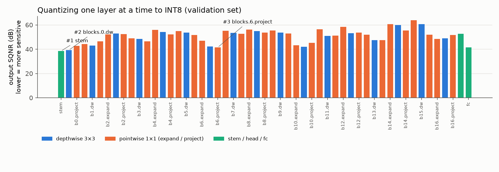
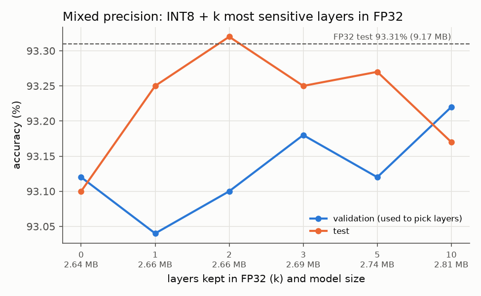
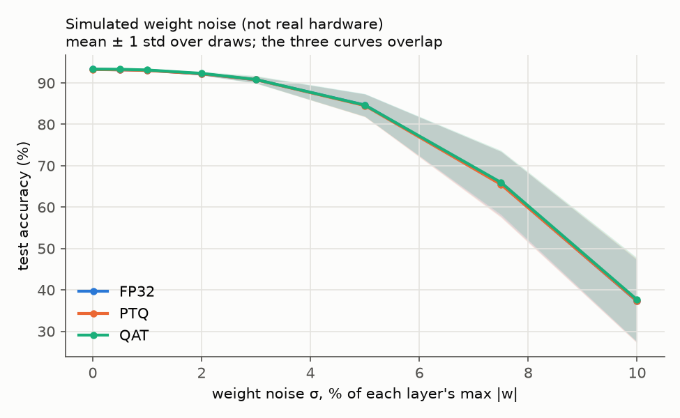

# MobileNetV2 INT8 quantization study (CIFAR-10)

This study takes a PyTorch model down to INT8 the way a deployment toolchain would:
- an FP32 baseline;
- static post-training quantization (PTQ);
- quantization-aware training (QAT);
- per-layer sensitivity analysis and mixed precision;
- a weight-noise robustness simulation (a stand-in for analog compute-in-memory non-idealities);
- ONNX export verified against ONNX Runtime on the CPU.

Every number below was produced by a script in `experiments/` and read from `results/*.json`. Each result file records the software versions, hardware, power plan and git commit at the start of its run.

## Results

<!-- BEGIN RESULTS (generated by experiments/report.py) -->
| Model | Test acc | Drop vs FP32 (95% CI) | Size (MB) | Size vs FP32 | PyTorch CPU ms (1 / 6 thr) | ORT CPU ms (1 / 6 thr) | ORT test acc |
|---|---|---|---|---|---|---|---|
| FP32 | 93.31% | — | 9.17 | 1× | 6.57 / 6.15 | 2.34 / 0.75 | 93.31% |
| INT8 PTQ | 93.10% | +0.21 pts (+0.06, +0.35) | 2.64 | 3.47× smaller | 4.36 / 3.35 | 1.33 / 0.61 | 93.25% |
| INT8 QAT | 93.44% | -0.13 pts (-0.37, +0.14) | 2.64 | 3.47× smaller | 4.34 / 3.30 | 1.36 / 0.59 | 93.30% |
| Mixed (INT8 + 3 FP32 layers) | 93.25% | +0.06 pts (-0.07, +0.20) | 2.69 | 3.40× smaller | 5.05 / 3.95 | 1.34 / 0.59 | 93.21% |

Drop = FP32 − model, so positive means accuracy lost. Latency: batch 1, median of 5×100 timed runs, pinned to performance cores. FP32 PyTorch latency is for the BN-folded model; unfolded FP32 is 7.88 / 8.03 ms. Sizes are `torch.save(state_dict)` files.
<!-- END RESULTS -->

Full tables (ONNX match, mixed-precision curve, top-10 sensitive layers, noise sweep, environment and the commit behind each result): [`results/summary.md`](results/summary.md). Resume-ready numbers: [`results/resume_numbers.txt`](results/resume_numbers.txt).

### Where accuracy is lost: per-layer sensitivity



Each bar quantizes **one** layer to INT8 (its input, weights and output) and leaves the rest in FP32. Bars are measured on the validation split. Single-layer accuracy changes on 5,000 images are within ±0.06 points, below what that set can resolve. So, by a rule fixed before looking at the data, layers are ranked by output-logit SQNR (signal-to-quantization-noise ratio, in dB). The most sensitive layers are:
- `stem`, the first conv. It sees the raw normalized image (3 channels, a wide signed range) and its errors propagate through every later layer.
- `blocks.0.dw`, the first depthwise conv: 32 channels at full 32×32 resolution, 9 weights per channel.
- `blocks.6.project`, a 384→64 projection with no ReLU, whose output feeds a residual add.

The most tolerant layers are late in the network: `blocks.15.expand` (63.8 dB), `blocks.14.expand` (60.8 dB) and `blocks.15.dw` (60.6 dB). Depthwise layers show up at both ends of the ranking, so "depthwise" alone doesn't predict sensitivity here; position in the network matters more.



Keeping the 3 most sensitive layers in FP32 recovers most of PTQ's 0.21-point loss (93.25% test) for +0.05 MB. The curve is flat within noise beyond that. The validation curve (used to pick the layers) and the test curve don't move together point by point, which is what you'd expect when the effects are this small.

### Weight-noise robustness (simulation, not hardware)



How the simulation works:
- Every conv and linear weight gets `w + N(0, (η·max|w_layer|)²)`, with 10 noise draws per level.
- Activations stay in float, so only the weights differ between FP32, PTQ and QAT.
- This is a deliberately simple stand-in for conductance programming and read noise. Drift, IR drop, ADC/DAC quantization and device non-linearity are **not** modelled.

Results:
- Accuracy holds to η ≈ 1% (93.1%), then falls: 90.8% at 3%, 84.7% at 5%, about 37% at 10%.
- **All three models degrade identically**; the curves overlap within one standard deviation.

## What surprised me

1. **Depthwise convs were not the problem at INT8.** The textbook MobileNetV2 failure is per-tensor weight quantization wrecking depthwise layers whose per-channel ranges differ by orders of magnitude. Here:
   - the widest depthwise channel is at most 5.4× the median one;
   - no channel rounds to zero under per-tensor scaling;
   - all four PTQ observer settings ({per-tensor, per-channel} × {min/max, histogram}) land between 93.07% and 93.26%.

   The failure is reported for ImageNet models with ReLU6. This CIFAR model, trained with weight decay on the depthwise weights, never grew outlier channels (`results/ptq.json` → `weight_stats`, `ablation`).
2. **QAT "beat" FP32, but the control explains it.** QAT reached 93.44% against FP32's 93.31%. The same 5 extra epochs *without* fake quantization, followed by PTQ, give 93.36%, so most of QAT's edge is extra training. The remaining 0.08 points is within noise. With only a 0.21-point PTQ loss, QAT had almost nothing to recover.
3. **INT8 QAT does not buy robustness to analog-scale noise.** INT8 rounding error has σ ≈ 0.23% of a layer's max |w|, (the uniform rounding error of a step of max|w|/127.5). That is roughly 9–44× smaller than the noise levels that hurt (η = 2–10%). The model never trains against perturbations that large. Training with noise injection at the target noise level would be the next experiment.
4. **PyTorch eager at batch size 1 is mostly overhead.** ONNX Runtime runs the same FP32 graph 2.8× faster on one thread (2.34 vs 6.57 ms) and the INT8 graph 3.3× faster (1.33 vs 4.36 ms). Mixed precision costs 16% more latency in PyTorch, which pays for every extra quantize/dequantize op, but nothing measurable in ORT.
5. **PyTorch INT8 and ORT INT8 are not bit-identical, and they fail the tolerance I set in advance.** For the PTQ model, logits differ by up to 4 output quantization steps (0.63 against logits of about ±25), and 35/10,000 predictions differ, against a limit of 10. Accuracy is unchanged (93.25% vs 93.10%). `experiments/06b_onnx_diagnosis.py` shows where the gap comes from: ORT with every optimization *disabled* is also off by up to 4 steps. In that mode the QDQ graph runs as plain dequantize → float conv → quantize, the ONNX reference math. So the gap comes from PyTorch's oneDNN INT8 kernels (int32 bias, requantization rounding) versus the QDQ reference, not from ORT's fused kernels, which stay within 2 steps of that reference.

## Method

| Step | Script | What it does |
|---|---|---|
| 0 | `experiments/00_env.py` | Records the environment. Fixes the split: 45,000 train / 5,000 validation, stratified with seed 0, from the official training set; the official 10,000 test images (`splits/cifar10_split.json` + sha256). |
| 1 | `01_train_fp32.py` | MobileNetV2 adapted to 32×32 inputs: stride-1 stem and stage 2, ReLU instead of ReLU6 so Conv+BN+ReLU can fuse (as torchvision's quantizable MobileNetV2 does), trained that way from scratch. 2.24 M parameters, 88 M multiply-adds per image. 60 epochs on the GPU with SGD (Nesterov), cosine schedule, bf16 autocast, crop + flip augmentation. |
| 2 | `02_ptq.py` | Fuse Conv+BN(+ReLU), PyTorch's default oneDNN qconfig, calibration on 1,024 *training* images. Ablation over weight granularity × activation observer × 3 calibration subsets. Per-layer weight statistics. |
| 3 | `03_qat.py` | Starts from the FP32 checkpoint. QAT fusion, fake quantization, 5 epochs (lr 0.005, cosine); BN statistics frozen from epoch 4, observers from epoch 5. Observers never see validation data. **Control:** identical fine-tuning without fake quantization, then PTQ. |
| 4 | `04_sensitivity.py` | One-layer-at-a-time INT8 on validation, then mixed precision with the k most sensitive layers in FP32 (k = 1, 2, 3, 5, 10). k = 3 was chosen as the headline in advance. |
| 5 | `05_noise.py` | Gaussian weight-noise sweep for the FP32, PTQ and QAT weights. |
| 6 | `06_onnx.py`, `06b_onnx_diagnosis.py` | FP32 exported with the dynamo exporter (opset 18). INT8 exported with the TorchScript exporter to QDQ ONNX (opset 17), which ORT fuses into QLinearConv/QLinearAdd/QGemm. All 10,000 test images compared against PyTorch. |
| — | `latency.py` | Batch-1 CPU latency. One process per thread count, pinned to that many performance cores (one logical CPU per P-core). All models interleaved over 5 shuffled rounds × 100 timed calls after a 0.5 s warmup; median reported. |
| 7 | `report.py` | Tables, figures and resume numbers from the JSON files. |

Choices made for rigor:
- Every selection (observer choice, which layers to protect) uses validation only; test accuracy is only reported.
- Accuracy drops come with paired-bootstrap 95% confidence intervals over the test images.
- The FP32 latency baseline has BN folded, so INT8's speedup isn't inflated by BN removal. Unfolded FP32 is 7.88 ms on 1 thread.

### Reproduce

```bash
py -3.11 -m venv .venv
.venv/Scripts/python -m pip install -r requirements.txt
.venv/Scripts/python scripts/download_data.py
.venv/Scripts/python experiments/00_env.py
.venv/Scripts/python experiments/01_train_fp32.py
.venv/Scripts/python experiments/02_ptq.py
.venv/Scripts/python experiments/03_qat.py
.venv/Scripts/python experiments/04_sensitivity.py
.venv/Scripts/python experiments/05_noise.py
.venv/Scripts/python experiments/06_onnx.py
.venv/Scripts/python experiments/06b_onnx_diagnosis.py
.venv/Scripts/python experiments/latency.py --models fp32 fp32_fused ptq qat mixed_3 ort:fp32 ort:ptq ort:qat ort:mixed_3 --tag final
.venv/Scripts/python experiments/report.py
```

Set `PYTHONUTF8=1` on Windows; the ONNX exporter and the report print non-ASCII characters. Datasets and weights (`data/`, `checkpoints/`) are not committed.

## Limitations

- **One dataset, one model, one training seed.** CIFAR-10 at 32×32 with a CIFAR-adapted MobileNetV2. The calibration-seed spread (about ±0.1 points) is measured, but training-seed variance is not.
- **CPU INT8 only**, measured on one laptop CPU (i7-12700H), using PyTorch's oneDNN engine (the only quantized engine in the Windows build of PyTorch 2.14.1) and ORT's MLAS kernels. No accelerator, no analog hardware.
- **The noise study is a simulation.** It uses Gaussian, weight-only noise relative to each layer's range. Real compute-in-memory adds drift, IR drop, ADC/DAC quantization and device-specific statistics.
- **Most effects are small.** The PTQ loss (0.21 points, confidence interval excludes 0) is real but tiny. The QAT and mixed-precision differences from FP32 are within the confidence intervals.
- **The INT8 export path uses deprecated APIs:** `torch.ao.quantization` eager mode and the TorchScript ONNX exporter. Both still work in PyTorch 2.14.1; the supported replacement is torchao's PT2E flow.
- **Latency is batch 1 on a laptop.** Medians are stable across rounds; p95 tails reflect OS noise. "Windows-10-10.0.26300" in the environment strings is Python's platform name for Windows 11 build 26300.

## Concepts

Plain-language notes on scale and zero-point, calibration, fusion, depthwise convs, QAT and sensitivity: [`docs/concepts.md`](docs/concepts.md).

## License

Code, results and figures are released under the [MIT License](LICENSE). CIFAR-10 is not included in this repository; `scripts/download_data.py` fetches it from its original source.
